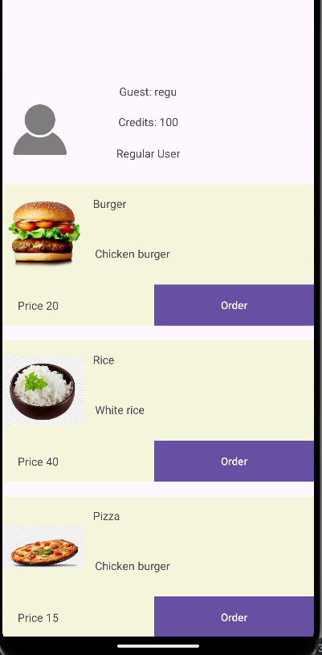
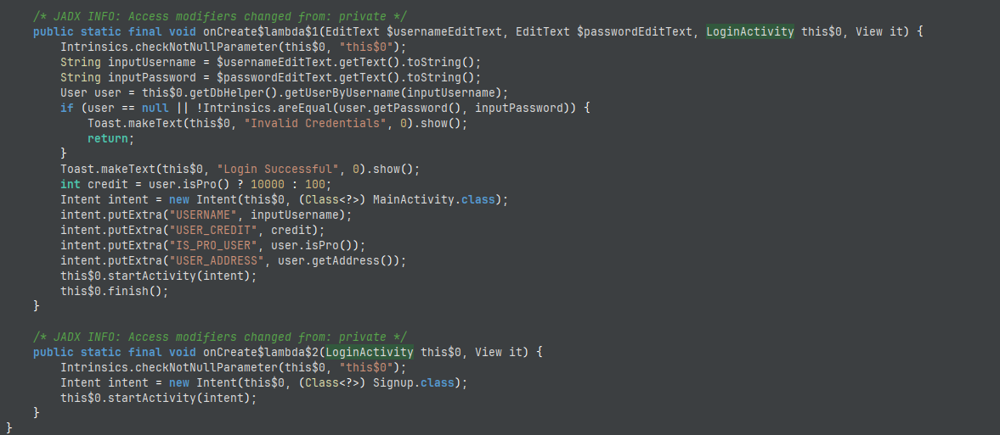
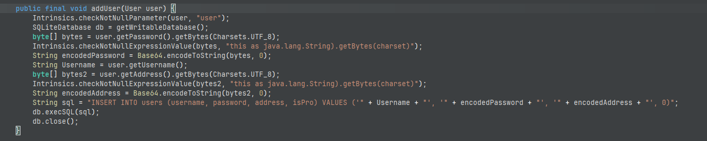
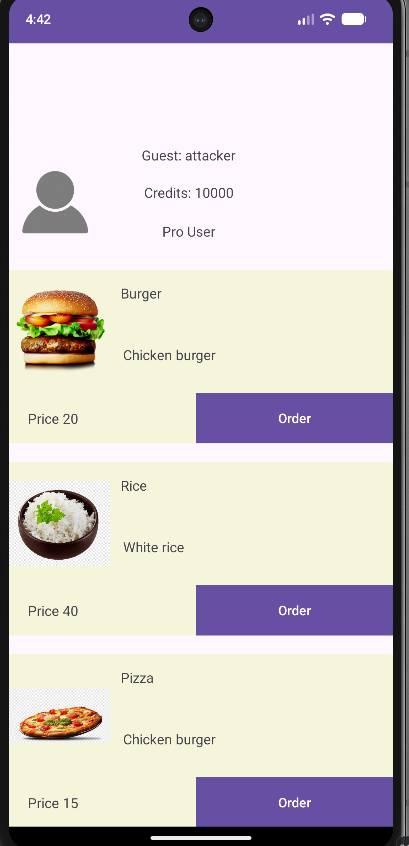

# Mobile Hacking Labs: Food Store

## Overview

This lab demonstrates an Android SQL injection vulnerability in a local SQLite database. The vulnerability exists in the application's user-registration flow, where user-controlled input is concatenated directly into an SQL `INSERT` statement.

## Objectives

- Analyze an Android APK using JADX
- Trace the login and registration flows
- Identify insecure SQLite query construction
- Exploit the vulnerability in an authorized lab environment
- Verify elevated account privileges
- Document secure remediation strategies

## Application Behavior

The application exposes two primary actions:

- **Login** — Authenticates an existing user and opens `MainActivity`
- **Signup** — Creates a new account in the local SQLite database

A newly registered standard user receives a credit balance of `$100`. Pro users receive a balance of `$10,000`.

## Static Analysis

I decompiled the APK using JADX and began by reviewing `LoginActivity`.

```java
String inputUsername = $usernameEditText.getText().toString();
String inputPassword = $passwordEditText.getText().toString();

User user = this$0.getDbHelper().getUserByUsername(inputUsername);

if (user == null || !Intrinsics.areEqual(user.getPassword(), inputPassword)) {
    Toast.makeText(this$0, "Invalid Credentials", 0).show();
    return;
}

int credit = user.isPro() ? 10000 : 100;

Intent intent = new Intent(this$0, MainActivity.class);
intent.putExtra("USERNAME", inputUsername);
intent.putExtra("USER_CREDIT", credit);
intent.putExtra("IS_PRO_USER", user.isPro());
intent.putExtra("USER_ADDRESS", user.getAddress());

this$0.startActivity(intent);
```

### Login Flow Findings

The login handler performs the following actions:

1. Reads the username and password from the UI.
2. Calls `getUserByUsername()` to retrieve an account record.
3. Compares the entered password with the stored password.
4. Sets the user credit according to the `isPro` property:
   - Standard user: `$100`
   - Pro user: `$10,000`
5. Passes user information to `MainActivity` through intent extras.

The `Signup` activity validates input fields, creates a `User` object, and passes it to `DBHelper.addUser()`.

## Vulnerable Code Path

The vulnerable behavior was located in the `DBHelper` class. The `addUser()` method Base64-encodes the password and address, then builds an SQL statement by concatenating strings with application input.

Conceptually, the vulnerable pattern resembles:

```java
String query =
    "INSERT INTO users (username, password, address, isPro) VALUES ('"
    + user.getUsername()
    + "', '"
    + encodedPassword
    + "', '"
    + encodedAddress
    + "', 0)";

database.execSQL(query);
```

### Root Cause

The application inserts attacker-controlled data into an SQL statement through string concatenation.

Because the username is placed directly inside the SQL query, an attacker can terminate the intended username string and inject additional SQL values. The hard-coded `isPro` value of `0` can therefore be bypassed.

## Exploitation

The following payload was submitted in the **username** field during registration:

```text
attacker','NjY2Ng==','NjY2Ng==', 1);--
```

The Base64 value `NjY2Ng==` represents `6666`, which was used as the password and address value in this lab.

The injected value changes the intended SQL insert so that a new record is created with:

| Field | Result |
|---|---|
| Username | `attacker` |
| Password | Base64-encoded `6666` |
| Address | Base64-encoded `6666` |
| `isPro` | `1` |

After registration, I logged in using the created account credentials and confirmed that the application treated the account as a pro user.

## Impact

This vulnerability allows a local attacker to manipulate database records and bypass application authorization controls.

Potential impact includes:

- Privilege escalation from standard user to pro user
- Unauthorized access to features intended for premium users
- Manipulation of application credit or reward values
- Creation of arbitrary database entries
- Possible compromise of integrity for locally stored user data

Although this challenge uses a local SQLite database, the underlying issue is applicable to any application that constructs SQL statements with untrusted input.

## Evidence

Add your screenshots to this section:

1. Initial login and signup screen  
   `Screenshots/login-screen.png`

2. Standard account showing `$100` credit  
   

3. Decompiled `LoginActivity` in JADX  
   

4. Vulnerable SQL construction in `DBHelper`  
   

5. Successfully created pro account showing `$10,000` credit  
   

## Remediation

The application should never build SQL queries through string concatenation. Use parameterized statements or Android's `ContentValues` API instead.

### Safer approach: ContentValues

```java
ContentValues values = new ContentValues();
values.put("username", user.getUsername());
values.put("password", encodedPassword);
values.put("address", encodedAddress);
values.put("isPro", 0);

database.insert("users", null, values);
```

### Safer approach: parameterized SQL

```java
String query =
    "INSERT INTO users (username, password, address, isPro) VALUES (?, ?, ?, ?)";

database.execSQL(
    query,
    new Object[] {
        user.getUsername(),
        encodedPassword,
        encodedAddress,
        0
    }
);
```

## Additional Security Improvements

- Do not use Base64 as a password-protection mechanism; Base64 is encoding, not encryption or hashing.
- Store passwords using a password hashing algorithm such as bcrypt, scrypt, Argon2, or PBKDF2 with a unique salt.
- Enforce authorization rules server-side for production applications.
- Avoid trusting client-side flags such as `isPro` for high-value authorization decisions.
- Add input validation, but do not rely on validation as a substitute for parameterized queries.
- Use least-privilege database access where possible.
- Add security testing for registration, authentication, and authorization workflows.

## Key Takeaways

- Decompiled Android applications can reveal insecure database handling patterns.
- SQL injection can occur in local SQLite databases, not only remote web databases.
- String concatenation with untrusted input is the root cause of this vulnerability.
- Base64 does not protect sensitive data.
- Parameterized queries and `ContentValues` prevent this class of SQL injection vulnerability.

## Tools Used

- JADX — APK decompilation and static analysis
- Android emulator/device — Dynamic testing
- MobileHackingLab — Authorized vulnerable-lab environment
- ADB/logcat — Optional runtime observation and debugging

