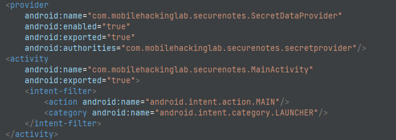
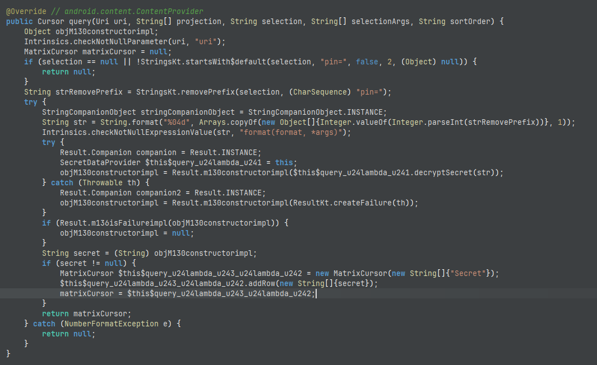
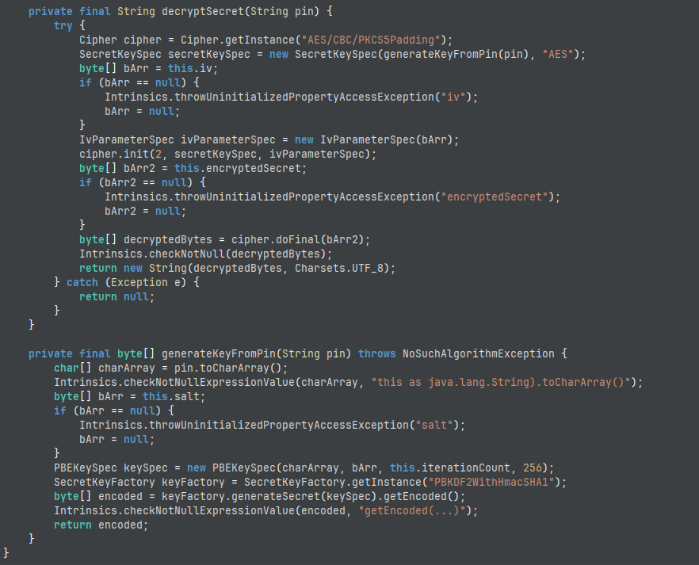
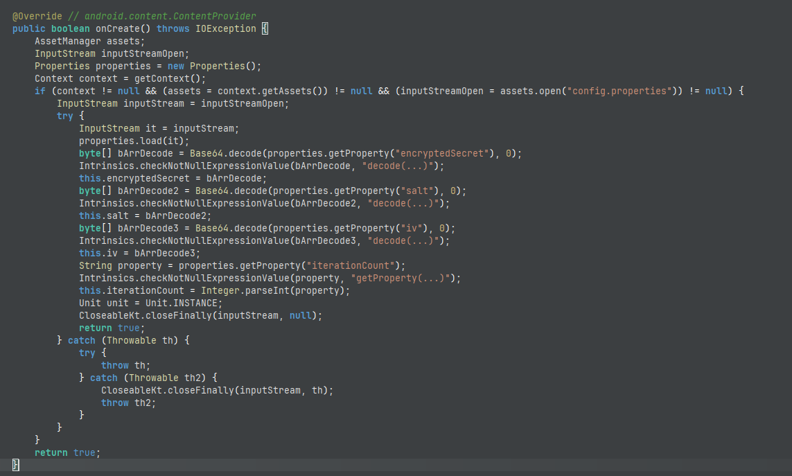
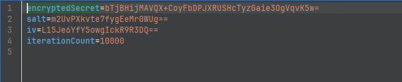
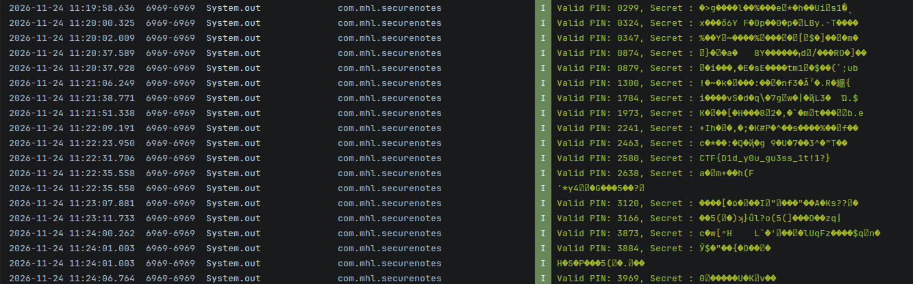

# Mobile Hacking Lab: Secure Notes

## Overview

In this lab, we analyze how Secure Notes protects an encrypted secret and reproduce its decryption logic in a Kotlin proof-of-concept application. By testing the 10,000 possible four-digit PINs against the extracted ciphertext, we recover PIN `2580` and a readable lab flag.

The investigation also identifies an exported content provider that accepts PIN candidates. The supplied runtime evidence demonstrates **offline decryption in the PoC**; it does not demonstrate successful queries to the original provider.

## Objectives

- Inspect the manifest and decompiled application logic in JADX.
- Trace the content provider's PIN-handling and decryption flow.
- Locate the ciphertext and cryptographic parameters in APK assets.
- Reproduce PBKDF2 key derivation and AES-CBC decryption in Kotlin.
- Enumerate four-digit PIN candidates and distinguish false positives from meaningful plaintext.
- Explain the demonstrated impact and relevant mitigations.

## Tools and Artifacts

| Tool or artifact | Role |
| --- | --- |
| JADX | Manifest, decompiled code, and asset inspection |
| Android Studio and Kotlin | PoC development and execution |
| Logcat | Inspection of candidate PINs and recovered plaintext |
| Secure Notes APK | Intentionally vulnerable lab target |

[Android PoC project](https://github.com/seddysed/AndroidApps/tree/main/SecurityTestingApps/securenotespoc)

## Static Analysis

### 1. Identifying an Exported Content Provider

We begin with `AndroidManifest.xml`, where the application declares `com.mobilehackinglab.securenotes.SecretDataProvider` as enabled and exported.

Its authority is:

```text
com.mobilehackinglab.securenotes.secretprovider
```

The provider declaration shown does not specify a permission requirement. This makes it an entry point worth investigating, although the declaration alone does not prove that an external query will succeed. Full permission handling and runtime behavior still need to be considered.



*The provider declaration identifies the component and its authority. The exported launcher activity below it is not, by itself, evidence of a vulnerability.*

### 2. Tracing the Query Interface

The provider's `query()` method expects the `selection` argument to begin with `pin=`. It removes the prefix, parses the remaining value as an integer, and formats that integer with `%04d` before calling `decryptSecret()`.

For values from `0` through `9999`, this produces four-digit strings with leading zeros. For example, `7` becomes `0007`. The format specifies a minimum width; it does not enforce a four-digit limit on input.

If decryption returns a non-null string, the method creates a `MatrixCursor` with a column named `Secret` and places the string in a row. Invalid numeric input or an unsuccessful decryption results in a null return in the shown flow.

Although the parameter is called `selection`, this implementation uses it to receive a PIN rather than as a SQL selection expression.



*The method connects a caller-supplied PIN to decryption and exposes the returned plaintext through a cursor. No attempt counter or delay is visible in this method.*

### 3. Understanding Key Derivation and Decryption

Following `decryptSecret()` leads to `generateKeyFromPin()`. Together, these methods describe the cryptographic process:

| Setting | Observed value or source |
| --- | --- |
| Password input | Candidate PIN converted to a character array |
| Key derivation | `PBKDF2WithHmacSHA1` |
| Requested key length | 256 bits |
| Salt | Loaded from configuration |
| Iterations | Loaded from configuration |
| Cipher transformation | `AES/CBC/PKCS5Padding` |
| Initialization vector | Loaded from configuration |
| Plaintext conversion | UTF-8 |

The derived key initializes the cipher for decryption. The method decrypts `encryptedSecret` and converts the resulting bytes into a string. If an exception occurs, it returns null.



*The relevant weakness is the limited PIN search space combined with an available offline test, rather than the AES key length itself.*

### 4. Locating the Cryptographic Parameters

The provider's `onCreate()` method opens `config.properties` from the APK assets. It reads and Base64-decodes `encryptedSecret`, `salt`, and `iv`, then parses `iterationCount` as an integer.



Inspecting the asset reveals the ciphertext, salt, IV, and an iteration count of `10000`.



*These values allow us to reproduce the application's decryption process outside the original application.*

Salt and IV values are not required to be secret. Their presence in the APK is not independently a vulnerability. In this case, the ciphertext and derivation logic are also available, allowing candidate PINs to be tested locally.

## Proof of Concept: Offline PIN Recovery

### Reproducing the Decryption Logic

We implement the same key derivation and decryption in a Kotlin Android application. The PoC uses the values extracted from `config.properties` and tests PINs from `0000` through `9999`.

The following excerpts summarize the supplied implementation. They are not a standalone Android project; the linked PoC project provides the application context. Any placeholder configuration values must be replaced with the Base64 values from the lab asset before running.

```kotlin
private fun generateKeyFromPin(pin: String): ByteArray {
    val keySpec = PBEKeySpec(pin.toCharArray(), salt, iterationCount, 256)
    val keyFactory = SecretKeyFactory.getInstance("PBKDF2WithHmacSHA1")
    return keyFactory.generateSecret(keySpec).encoded
}

private fun decryptSecret(pin: String): String? {
    return try {
        val cipher = Cipher.getInstance("AES/CBC/PKCS5Padding")
        val key = SecretKeySpec(generateKeyFromPin(pin), "AES")
        cipher.init(Cipher.DECRYPT_MODE, key, IvParameterSpec(iv))
        String(cipher.doFinal(encryptedSecret), UTF_8)
    } catch (_: Exception) {
        null
    }
}
```

The enumeration loop preserves leading zeros:

```kotlin
for (i in 0..9999) {
    val pin = String.format(Locale.US, "%04d", i)
    val secret = decryptSecret(pin)
    if (secret != null) {
        println("Valid PIN: $pin, Secret : $secret")
    }
}
```

### Reproduction Procedure

1. Inspect the lab APK in JADX and open its `config.properties` asset.
2. Copy the Base64 ciphertext, salt, and IV into the PoC's corresponding fields. Set the iteration count to the observed value, `10000`.
3. Build and run the PoC in Android Studio on the test Android environment.
4. Open Logcat for the PoC process, `com.mhl.securenotes`, and inspect its `System.out` messages.
5. Review the candidate outputs and identify the readable lab flag.

In the supplied implementation, `onCreate()` calls `sploit()`, which performs the local enumeration. The call to `readContentProvider()` is commented out. Therefore, this run does not depend on querying the original provider.

The enumeration currently runs on the UI thread and can make the PoC unresponsive. A revised implementation should move the computation to a background dispatcher and report progress to the UI.

### Distinguishing False Positives

The original log message labels every non-null result as a “Valid PIN.” That wording is too strong: it only means the candidate did not cause a decryption exception.

With an incorrect key, decrypted bytes can occasionally have acceptable padding. Converting those bytes to UTF-8 can yield unreadable characters without throwing an exception. A non-null string alone therefore does not verify the PIN.

We treat these outputs as candidates and inspect the plaintext for the recognizable lab flag. A clearer future log label would be `Candidate PIN`.

### Recovered Result

The captured output includes the following readable result:

```text
Valid PIN: 2580, Secret : CTF{D1d_y0u_gu3ss_1t!?}
```



*PIN `2580` produces the readable flag, while several other candidates produce unreadable output. The screenshot demonstrates plaintext recovery; it does not show a separate challenge-submission confirmation.*

## Demonstrated Impact and Limitations

An analyst with access to the lab APK can extract the ciphertext and cryptographic parameters and reproduce the decryption logic locally. Enumerating the four-digit PIN space recovers the readable secret without using the original application's PIN-entry interface.

The candidate space contains only 10,000 PINs. PBKDF2 increases the work required per candidate but does not increase the entropy of the PIN. UI-based delays or attempt limits would not prevent this independent offline enumeration.

| Finding | Evidence status |
| --- | --- |
| Enabled, exported provider declaration | Observed in the manifest screenshot |
| PIN accepted through the provider's selection argument | Observed in decompiled code |
| Ciphertext and derivation parameters available in assets | Observed in initialization code and configuration |
| Offline recovery of the readable lab flag using PIN 2580 | Demonstrated in Logcat |
| Successful cross-application provider query | Not demonstrated by this run |

## Remediation

### Strengthen Secret Protection

Avoid protecting sensitive material solely with a key deterministically derived from a short PIN when ciphertext is available for offline testing. A larger AES key does not compensate for a small password space.

For device-bound secrets, consider Android Keystore-backed key management with authentication requirements appropriate to the application's threat model. A stronger passphrase and a suitably configured password-based KDF can increase resistance to guessing, but merely raising the iteration count does not remove the underlying four-digit search space.

### Restrict Provider Access

If the provider is only needed internally, disable external access with `android:exported="false"`. If cross-application access is necessary, use permissions and explicit authorization appropriate to the intended callers. Review inherited and application-level permission settings as part of that assessment.

Provider restrictions reduce the exposed IPC surface. They do not, by themselves, prevent the demonstrated offline attack against ciphertext and PIN-derived keys extracted from the APK.

### Authenticate Ciphertext

Use authenticated encryption, such as AES-GCM with correct nonce management, to detect ciphertext modification and reject incorrect-key results reliably. Authenticated encryption improves integrity and validation but does not make a four-digit PIN resistant to exhaustive offline guessing.

### Avoid Sensitive Logging

Logging the recovered secret is useful evidence in this training PoC. Production applications should avoid writing PINs, keys, or plaintext secrets to logs.

## Key Takeaways

- Trace data from manifest entry points through application logic to its storage source.
- A four-digit PIN remains a small search space even when it derives a 256-bit key.
- Bundled ciphertext and reproducible key derivation can enable offline guessing.
- Successful padding is not proof that a candidate key is correct.
- Separate observed code behavior, demonstrated exploitation, and untested hypotheses.

## Scope

This write-up documents analysis of an intentionally vulnerable Mobile Hacking Lab application in a training environment. Results and impact statements are limited to the code and runtime evidence presented above.
